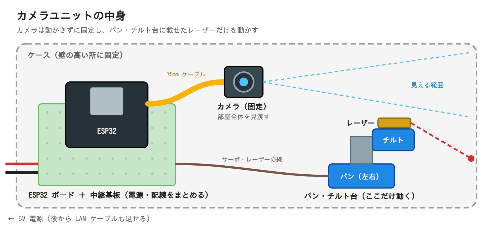
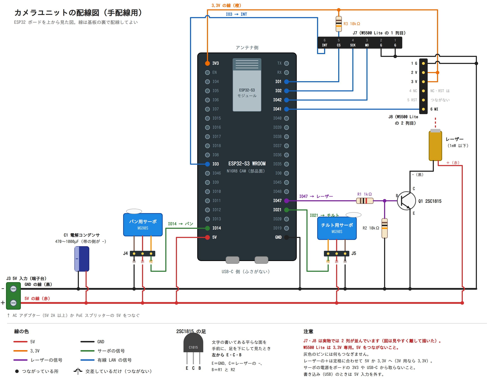
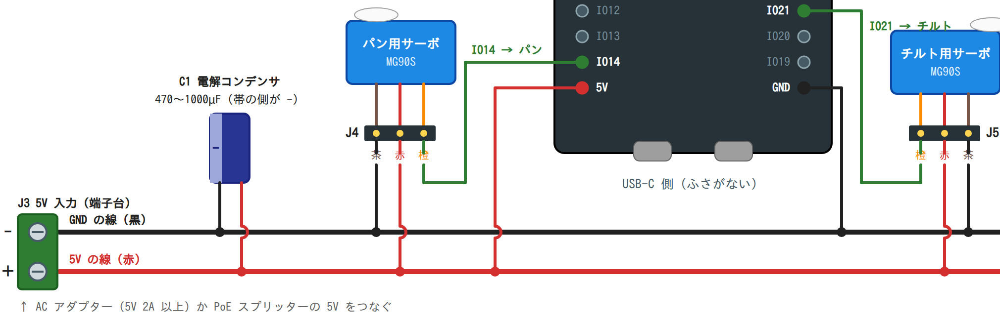
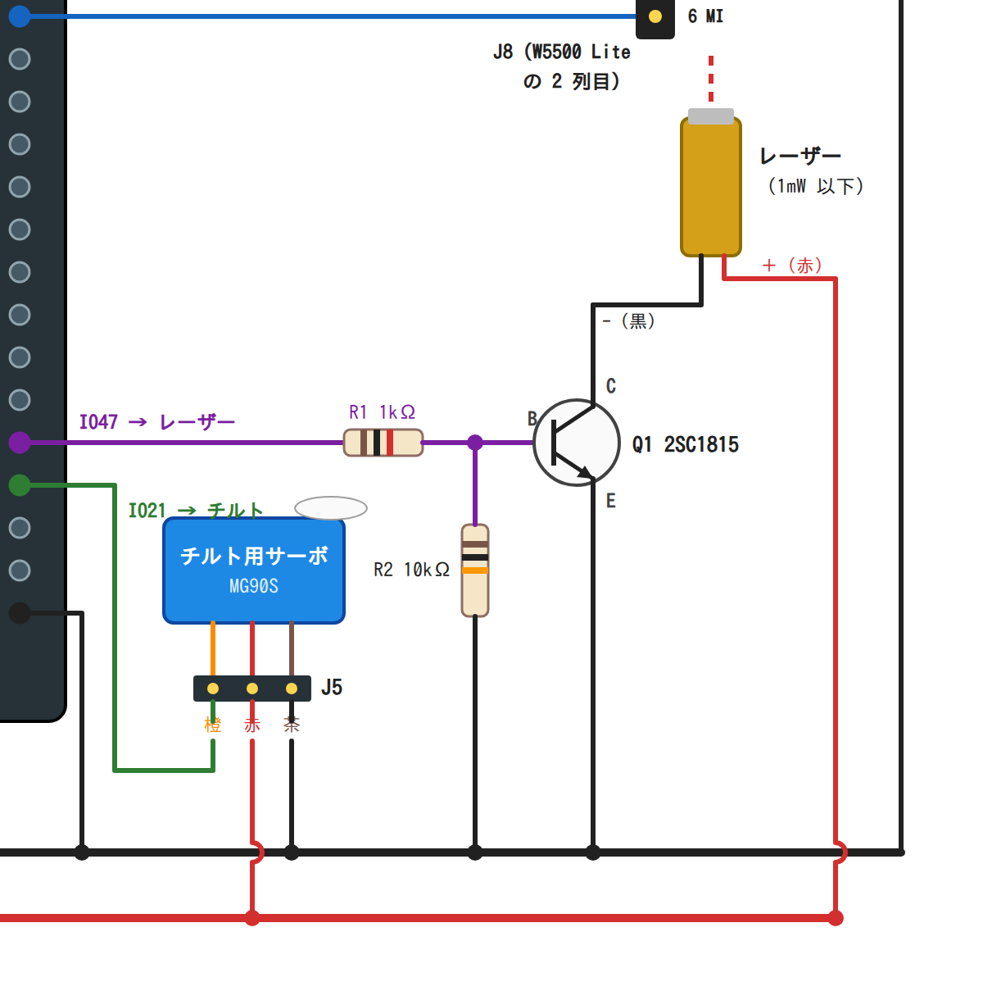
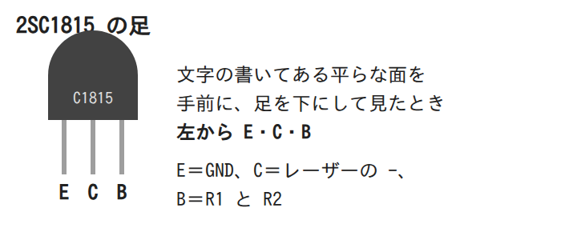
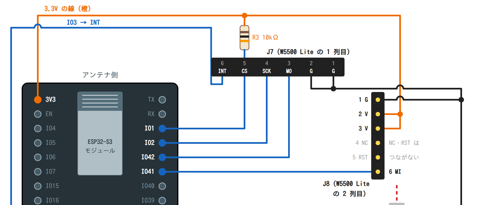
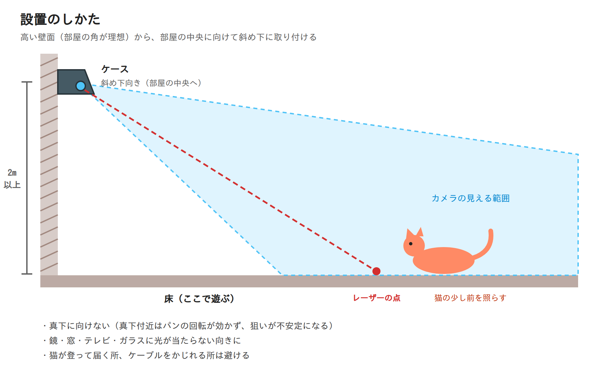

# ハードウェア（部品・配線・設置）― ESP32 構成

壁に付けるのは「カメラ付き ESP32 ＋ パン・チルト台に載せたレーザー」だけです。猫の認識は NAS のコンテナが行います。

## 部品

| 部品 | 選んだもの | 数 | メモ |
| --- | --- | --- | --- |
| カメラ付きマイコン | **ESP32-S3 CAM（ESP32-S3-WROOM-1 N16R8、USB-C ×2）** | 1 | Freenove ESP32-S3-WROOM CAM 互換の配置。カメラ別売りの「Single module」で可 |
| カメラ | **OV2640 120° レンズ版（24 ピン、ケーブル 75mm）** | 1 | 赤外線カット付きの通常版（「850nm」「Night Vision」版は避ける） |
| サーボ | **MG90S（金属ギア、180°）** | 2 | 「360°（連続回転）」版は使えない。予備に 1 個あると安心 |
| パン・チルト台 | SG90 / MG90S 用 2 軸ブラケット | 1 | サーボの付属ホーンを切って合わせるのが普通 |
| レーザー | 赤色 650nm **1mW 以下** | 1 | 秋月電子「赤色ドットレーザーモジュール 8mm×19mm 1mW」を推奨（下記） |
| トランジスタ | 2SC1815 ＋ 1kΩ 抵抗 ＋ 10kΩ 抵抗 | 各 1 | レーザーの ON/OFF 用（10kΩ は起動中にレーザーが勝手に点かないようにする） |
| 電源 | 5V 2A 以上の AC アダプター | 1 | サーボ 2 個とボードをまとめて給電する |
| コンデンサ | 電解コンデンサ 470〜1000µF（10V 以上） | 1 | サーボが動き出すときの電圧低下でボードが再起動するのを防ぐ |
| 有線 LAN 用の口 | ピンヘッダー（メス）1×6 ×2 ＋ 10kΩ 抵抗 | 各 1 | W5500 Lite をそのまま挿せるようにしておく（下記「有線 LAN 用の口」） |
| その他 | ユニバーサル基板（またはプリント基板 → [pcb.md](pcb.md)）・ジャンパワイヤ・ケース・固定具 | | |
| 有線 LAN | W5500 Lite（6 本 × 2 列、3.3V 専用） | 1 | 挿さなければ Wi-Fi で動く |

### レーザーの選び方

- **必ず出力 1mW 以下（JIS / IEC の Class 1 または 2）を選んでください。**
  電子工作用の「レーザーダイオードモジュール」は 5mW（Class 3R）のものが多く、猫にも人にも危険です。
- 通販のノーブランド品は表記より出力が強いことがあります。出力が明記されている国内の電子部品店の品が確実です。
- 赤（650nm）が一般的です。猫は赤を見分けにくいとも言われますが、動く光点にはよく反応します。

## 配線

後から有線 LAN（W5500 Lite）を足せるように、**最初から「有線 LAN 用の口」（6 ピンのヘッダー 2 列）を用意しておく**配線です。
W5500 を挿さなければ今までどおり Wi-Fi で動き、挿せばケーブルを挿すだけで有線にできます（ファームウェアが自動で切り替える予定）。

### 配線図

画像をクリックすると拡大できます。**印刷用は [PDF](images/wiring.pdf)**（印刷するときに「用紙に合わせる」を選ぶと A4 横・A3 横に収まります）、拡大しても粗くならない版は [SVG](images/wiring.svg) です。
（ピンの並びが違って描き直すときは `docs/images/` の `wiring_diagram.py` → `render.py`）

- 赤＝5V、黒＝GND、橙＝3.3V。**●** はつながっている所、**半円で飛び越えている所**は交差しているだけ（つながない）です。
- 下の 2 本（5V の線と GND の線）は、ユニバーサル基板の端に沿って太めの線を 2 本通し、各部品をそこへつなぐ形にすると配線が楽です。
- ボードのピンの並びは、届いたボード（ESP32-S3 WROOM N16R8 CAM、片側 20 本）の印字に合わせてあります。

### 組み立ての順番（ユニバーサル基板）

1. **ESP32 ボード用のメスのピンヘッダー 2 列**を先に付ける。ボードを挿した状態ではんだ付けすると、列の間隔がずれない
   （はんだ付けの熱が伝わらないよう、1 列の両端だけ留めたらボードを抜いて残りを付ける）。
   ボードのアンテナ側の端は、ユニバーサル基板の外にはみ出すように置くと電波が弱まりにくい。
2. **5V の線と GND の線**を基板の端に沿って 2 本通す（太さ 0.3mm² 以上、または AWG22 程度。サーボで 2A 近く流れる）。
3. **端子台（J3）・電解コンデンサ（C1）・サーボの口（J4・J5）**を付けて、5V の線と GND の線へつなぐ。
4. **ボードの 5V・GND**（左列の下 2 本）を 5V の線と GND の線へつなぐ。
5. **信号線**（IO14・IO21・IO47）と、**レーザーの部分**（R1・R2・Q1）を付ける。信号線は細い線（AWG26〜28 やポリウレタン線）でよい。
6. **有線 LAN 用の口（J7・J8）・R3** と、3.3V・IO1・IO2・IO3・IO41・IO42 の線を付ける。W5500 Lite を挿さなければ Wi-Fi で動くので、付けておくだけでも構いません。
7. **電源を入れる前に、テスターで確かめる**:
   - 5V の線と GND の線の間が導通していない（ショートしていない）
   - ボードの 5V ピン・3V3 ピン・GND ピンが、それぞれ正しい線とつながっている
   - 2SC1815 の向き（平らな面を手前に、左から E・C・B）
8. **ESP32 ボードを挿さずに 5V 入力をつなぎ**、ボードの 5V ピンの所に 5V が来ていることをテスターで確かめる。
9. 5V 入力を外してから ESP32 ボードを挿し、USB でファームウェアを書き込む（[firmware/README.md](../firmware/README.md)）。
10. USB を外して 5V 入力から動かし、操作画面の「調整」で、スライダーでサーボが動くこと・「レーザーを点ける」でレーザーが点くことを確かめる。

### 電源とサーボ

- 5V 入力は、AC アダプターでも、PoE スプリッターの 5V 出力でも同じ所につなぎます。
- **GND（−）はすべてつなげます。** 電源・サーボ・ボード・トランジスタ・W5500 の GND が共通でないと動きません。
- サーボの電源はボードの 3.3V から取らないでください（電流が足りずボードが落ちます）。
  ボードの USB-C を通してサーボに給電するのも避けます（ボードの配線が電流に耐えられません）。
- コンデンサには向きがあります（足の短い方・帯の側が −）。逆につなぐと壊れます。
  サーボの近く（5V と GND が分かれる所）に付けると効きます。

### レーザー

- 10kΩ はベースと GND の間に入れます。電源を入れた直後や書き込み中は GPIO47 の状態が決まらないので、
  これがないとレーザーが一瞬点くことがあります。

### 有線 LAN 用の口（W5500 Lite を挿すヘッダー）

W5500 Lite のピンの並びに合わせて、1×6 のメスのピンヘッダーを 2 列（J7・J8）付けます。
W5500 Lite はそのまま上から挿します（2 列の間隔は W5500 Lite に合わせる。1 番どうし（G）を同じ端にそろえる）。

| 口 | 番号 | W5500 Lite の印字 | つなぐ先（ボード側） |
| --- | --- | --- | --- |
| J7 | 1 | G | GND |
| J7 | 2 | G | GND |
| J7 | 3 | MO（MOSI） | IO42 |
| J7 | 4 | SCK | IO2 |
| J7 | 5 | CS | IO1（**10kΩ で 3.3V へつなぐ**） |
| J7 | 6 | INT | IO3 |
| J8 | 1 | G | GND |
| J8 | 2 | V | 3V3 |
| J8 | 3 | V | 3V3 |
| J8 | 4 | NC | つながない |
| J8 | 5 | RST | つながない（ファームウェアが通信でリセットする） |
| J8 | 6 | MI（MISO） | IO41 |

- W5500 Lite は **3.3V 専用**です（印字の V＝3.3V。5V をつなぐと壊れます）。130mA ほど使うので、有線のときは Wi-Fi を止めて合計を抑えます（ファームウェアで対応）。
- J7 の 5 番（CS）には **10kΩ の抵抗を 3.3V との間に**入れておきます（電源を入れた瞬間に W5500 が誤動作しないように）。
- **IO2 はボード上の LED にもつながっている**ので、ESP32 が出力する SCK に使います（W5500 が出力する MISO に使うと、LED の分だけ信号が弱まるおそれがある）。通信中は LED が点滅しますが、害はありません。
- ジャンパワイヤでつなぐ場合は、**W5500 までの線を 15cm 以内**にしてください。速い信号（20MHz）なので、長いと通信が不安定になります。
- W5500 Lite を挿していなくても、この口は付けたままで問題ありません（ファームウェアが W5500 の有無を確かめて、なければ Wi-Fi で動きます）。

### ピンの使い方（まとめ）

| GPIO | 用途 |
| --- | --- |
| 4〜13・15〜18 | カメラ（ボード上で配線済み） |
| 14 / 21 | パン / チルト用サーボ |
| 47 | レーザー（2SC1815 経由） |
| 0 | BOOT ボタン（ON/OFF） |
| 48 | ボード上の RGB LED |
| 2 / 42 / 41 / 1 / 3 | **有線 LAN 用**（SCK / MOSI / MISO / CS / INT）。IO2 にはボード上の LED もつながっている |
| 35〜37 | **使用禁止**（内蔵メモリ PSRAM。ボードの印字に「*」が付いている） |
| 38〜40 | 使わない（ボードによっては microSD スロットにつながっている） |
| 19 / 20 | 使わない（USB-C の「USB」側） |
| 43 / 44 | 使わない（USB-C の「COM」側＝書き込み用） |
| 45 / 46 | 使わない（起動のしかたを決めるピン。つなぐ物によっては起動しなくなる） |

### その他

- この配線をプリント基板にする手順は [pcb.md](pcb.md) にあります（EasyEDA での描き方・接続表・回路図の照合）。
- **書き込み（USB 接続）のときは 5V 入力を外しておく**と安全です。
- ON/OFF ボタンには、ボード上の **BOOT ボタン**を使います（押すたびに ON/OFF が切り替わります）。
  手の届く所に置きたい場合は、タクトスイッチを GPIO0 と GND の間に配線して延長できます
  （電源を入れる瞬間に押していると書き込みモードで起動するので注意）。

## 設置

- **高い壁面（部屋の角が理想）から、部屋の中央に向けて斜め下に**取り付けるのがおすすめです。
  - 物体検出モデルは普通の写真で学習しているため、真上から見下ろすより斜めから見たほうが猫を見つけやすい。
  - パン・チルト台を真下に向けると、真下付近でパンの回転が効かなくなり、狙いが不安定になる。
- **カメラは動かさず固定します。** 動くのはパン・チルト台のレーザーだけです。
  カメラ画像の座標とサーボの角度の対応表（キャリブレーション）を作るので、カメラが動くと狙いが合わなくなります。
- カメラはパン・チルト台の土台の近くに、部屋全体が写る向きで固定します。近いほど、ソファの上など床より高い場所での狙いのずれが小さくなります。
- カメラのケーブルは曲げを繰り返すと傷むので、動く部分には載せず、ケースにしっかり固定してください。
- 取り付けがずれたら `cattoy calibrate` をやり直します。
- 猫が登って届く場所・ケーブルを噛める場所は避けてください。
- 鏡・窓・テレビ・ガラスのテーブルなど、光を反射する物にレーザーが当たらない向きにします。
- Wi-Fi の電波が届く場所にしてください（操作画面に ESP32 の電波強度が出ます。-70 dBm より弱いと映像が途切れがちになります）。
  電波が弱い場合は、「有線 LAN 用の口」に W5500 を挿して有線にできます。
